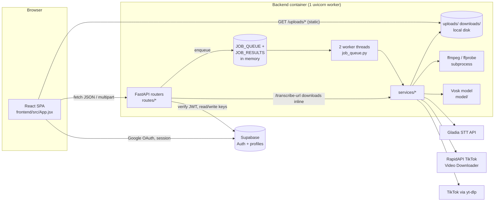
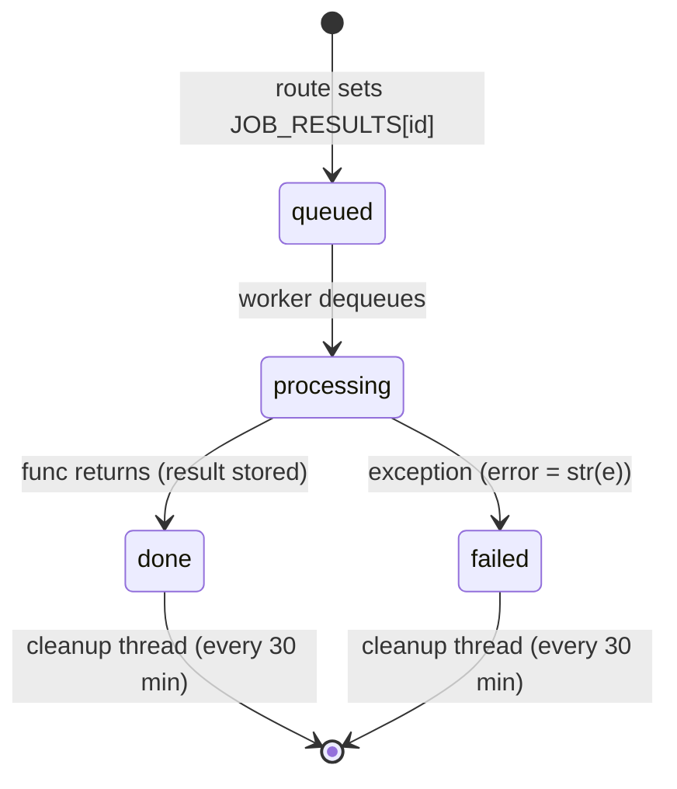
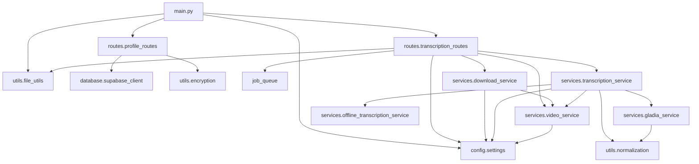

# Architecture

> Based on the code as of 2026-11-13 (commit `d2f8fb7`). Items marked **(unverified)** were inferred but not exercised at runtime.

## Overview

Video Transcript Generator is a two-tier web app:

- **Backend**: a FastAPI service in [`backend/`](../backend/). It downloads or accepts videos, runs ffmpeg, sends audio to a speech-to-text provider, indexes the words, and renders muted exports. It runs in Docker on Render.
- **Frontend**: a React 19 + Vite single-page app in [`frontend/`](../frontend/). It uploads media, polls for results, plays the video with a word-synced transcript, and lets users mute words and export. It is hosted on Vercel.
- **Supabase**: Google OAuth login (frontend) and a `profiles` table holding each user's encrypted third-party API keys (backend).

There is no database of transcripts or jobs. All job state and media files are temporary and live inside the single backend process and its local disk.

## Components and responsibilities

| Component | Location | Responsibility |
|---|---|---|
| App bootstrap | [`backend/main.py`](../backend/main.py) | Builds the `FastAPI` app, creates the media directories, configures CORS, mounts `/uploads`, `/downloads` and `/download` as static directories, and includes the routers. |
| Transcription router | [`backend/routes/transcription_routes.py`](../backend/routes/transcription_routes.py) | HTTP surface for transcription, job polling, export and file download. Builds job closures and enqueues them. |
| Profile router | [`backend/routes/profile_routes.py`](../backend/routes/profile_routes.py) | Saves, reads and deletes a user's encrypted API keys in Supabase after verifying their JWT. |
| Job system | [`backend/job_queue.py`](../backend/job_queue.py) | Thread-based queue with 2 workers, an in-memory results dict, and a cleanup thread that runs every 30 minutes. |
| Download service | [`backend/services/download_service.py`](../backend/services/download_service.py) | TikTok URL cleanup and resolution, RapidAPI download, yt-dlp fallback, video-stream detection. |
| Transcription service | [`backend/services/transcription_service.py`](../backend/services/transcription_service.py) | `process_video`: extract audio, choose the STT provider, build the word index and frequency list. |
| Gladia service | [`backend/services/gladia_service.py`](../backend/services/gladia_service.py) | Uploads audio, starts and polls a Gladia transcription, flattens the result into words. |
| Offline STT | [`backend/services/offline_transcription_service.py`](../backend/services/offline_transcription_service.py) | Vosk/Kaldi recognition over 10-second chunks. The model is lazy-loaded. |
| Video service | [`backend/services/video_service.py`](../backend/services/video_service.py) | ffprobe duration, audio extraction, trimming, mute export. |
| Utilities | [`backend/utils/`](../backend/utils/) | Word normalization lists, Fernet encryption, delayed file deletion. |
| Settings | [`backend/config/settings.py`](../backend/config/settings.py) | Directories and limits. |
| Supabase client | [`backend/database/supabase_client.py`](../backend/database/supabase_client.py) | Loads `.env` and creates a module-level service-role client. |
| SPA | [`frontend/src/App.jsx`](../frontend/src/App.jsx) | Holds all UI state and handlers: upload, URL transcribe, export, key management, auth session, mute preview. |
| API helpers | [`frontend/src/api/`](../frontend/src/api/) | `transcribe.js` (submit and poll) and `supabase.js` (anon client). |

## Execution model

### Backend startup (import-time side effects)

`uvicorn main:app` is run **from inside `backend/`**, because all imports are written relative to that directory. Importing `main.py` triggers this chain:

1. `config.settings` computes `UPLOAD_DIR`/`DOWNLOAD_DIR` as `backend/uploads` and `backend/downloads`.
2. `routes.profile_routes` imports `database.supabase_client`, which calls `load_dotenv(backend/.env)` and `load_dotenv(<repo>/.env)`, then `create_client(SUPABASE_URL, SUPABASE_SERVICE_KEY)`. **If those variables are missing, startup fails here.** It also imports `utils.encryption`, which builds the Fernet cipher (or generates a throwaway key if none is set).
3. `routes.transcription_routes` imports `job_queue`, which **starts 2 worker threads and 1 cleanup thread**. It also imports the services; `gladia_service` and `transcription_service` read `GLADIA_API_KEY` at this point. That only works because step 2 already loaded `.env`.
4. `main.py` creates the directories, configures CORS, mounts the static directories and includes the routers.

### Request handling

- Short operations (job lookup, profile routes, file download) run inside the request.
- **Long operations run on the job queue**: transcription (`process_video`) and export (`apply_mute_edits`). The route returns `{job_id}` immediately and the client polls `GET /job/{job_id}`.
- **Exception:** `/transcribe-url` runs the whole TikTok download (RapidAPI or yt-dlp, plus trimming) synchronously inside the async route before enqueuing. That blocks the event loop while it runs **(unverified impact, but the call is a blocking `requests`/yt-dlp call inside `async def`)**.

### Job lifecycle

The cleanup thread wakes every 1800 s and removes every `done`/`failed` job, so a result can disappear anywhere from a few seconds to 30 minutes after it finishes. The frontend treats a 404 as "Job expired or not found".

## Key architectural decisions and patterns

- **In-process queue instead of an external broker.** This is simple, but it requires exactly one server process. The Dockerfile pins `--workers 1`. Restarting the process loses every queued and finished job and every pending deletion timer.
- **Poll-based async API.** The client polls with backoff of 2 s rising to 5 s and gives up after 120 s ([`frontend/src/api/transcribe.js`](../frontend/src/api/transcribe.js)).
- **Bring-your-own API keys.** Gladia and RapidAPI keys normally come from the user on each request. Supabase only *persists* them for convenience; the backend never fetches stored keys on its own. A server-wide `GLADIA_API_KEY` is an optional default.
- **Graceful STT degradation.** No Gladia key, or *any* Gladia exception, falls back to the bundled offline Vosk model (English small model).
- **Ephemeral disk storage.** Uploads, downloads and WAVs live in local directories, are served by `StaticFiles`, and are deleted by `delete_later` timer threads (30 minutes for transcription inputs). Export outputs are never deleted.
- **Hard 60-second cap by trimming, not rejection.** Every input goes through `trim_video` (`MAX_VIDEO_DURATION = 60`).
- **Domain-specific normalization.** `utils/normalization.py` contains a hand-curated list of brand names (TikTok, Facebook, Shopee, Lazada, "yellow basket"…). It is used both to bias Gladia (custom vocabulary) and to merge variants in the word index.
- **Layering.** Routes parse and validate input and enqueue work. Services do the work and raise `HTTPException` directly. Utilities hold no request context. Request bodies are plain `dict`s; there are no Pydantic models.

## Module dependency graph

## Coupling and fragile areas

| Area | Why it is fragile |
|---|---|
| Import order in `backend/main.py` | `GLADIA_API_KEY` is read at import by `gladia_service`/`transcription_service`, but `.env` is only loaded by `supabase_client`, which `profile_routes` imports first. Reordering the router imports silently drops the server-side Gladia key. |
| Single-process job store | `JOB_RESULTS` is a module-level dict. Multiple uvicorn workers or instances would cause 404s on polling. |
| Result shape contract | `App.jsx` reads `audio_file`, `video_file`, `transcript`, `export_available` and `tiktok_metadata` directly. Changing `create_transcription_job` breaks the UI without warning. |
| `download_tiktok` return tuple | It returns a 4-tuple `(path, export_available, metadata, method)`. History shows earlier unpacking bugs (commit `4e776b0`). |
| Mute timing offset | The backend (`apply_mute_edits`) and the frontend preview (`App.jsx` mute effect) both shift by **−0.1 s** independently. |
| Export window | Export reads the source from `uploads/`, which is deleted 30 minutes after transcription. |
| Gladia error masking | `process_video` catches *every* Gladia exception and falls back to Vosk, so invalid keys and quota errors never reach the user. The "Invalid Gladia API key" mapping in the frontend is effectively unreachable for Gladia failures. |
| Rate limiting | The routes use their own `Limiter`, while `main.py` sets `app.state.limiter = None` and registers slowapi's default handler, which reads `app.state.limiter`. A limit hit likely produces a 500 (handler source confirmed; not exercised at runtime). |
| Vosk model path | `get_vosk_model()` resolves to `backend/model`, but the model is at repo-root `model/`. Only Docker's `/app/model` works, so the offline fallback fails in local runs. |
| Third-party scraping | TikTok extraction through yt-dlp breaks frequently. The Dockerfile force-upgrades yt-dlp at build time, and the RapidAPI provider has been swapped several times (see git history). |
| Legacy duplicate | The repo-root [`main.py`](../main.py) is an older single-file backend with overlapping routes. It is not deployed, but it is the only place `/download-raw` exists, and the frontend still calls that route. |
