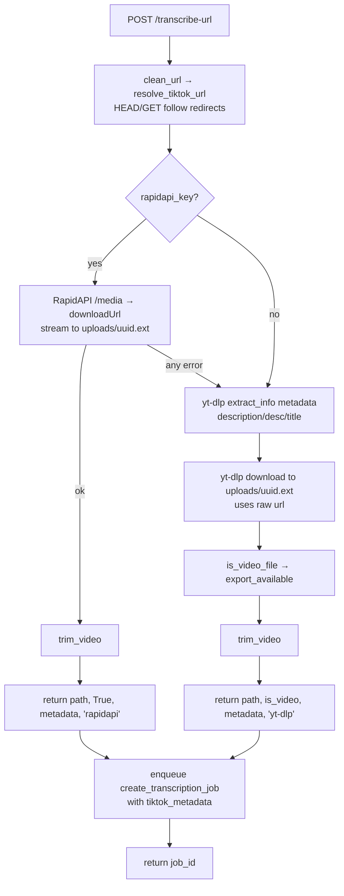
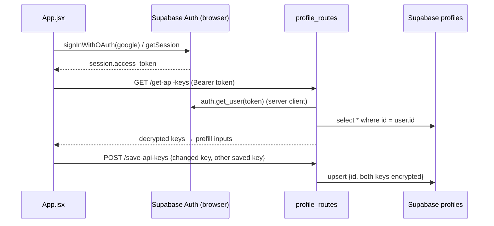

# Data Flow

> Based on the code as of 2026-11-13. All paths are relative to `backend/` at runtime, with `UPLOAD_DIR = backend/uploads` and `DOWNLOAD_DIR = backend/downloads`.

## Input sources

| Input | Entry point | Validation |
|---|---|---|
| Uploaded media file | `POST /transcribe` (multipart `file`, `gladia_api_key?`, `language`) | Size ≤ `MAX_FILE_SIZE` (100 MB) measured by seeking the spooled file. The frontend `accept="video/*"` is a hint only; the server does no type check. |
| TikTok URL | `POST /transcribe-url` (JSON `url`, `gladia_api_key?`, `rapidapi_key?`, `language?`) | `url` must be present (400 otherwise). The frontend additionally requires `"tiktok.com"` in the string. |
| Mute selections | `POST /export-video` (JSON `filename`, `mutes`) | `filename` required. `mutes` must be a list if present. `os.path.basename(filename)` blocks path traversal, and the source must exist in `UPLOAD_DIR` (404 otherwise). |
| User API keys | Request fields above, or `POST /save-api-keys` | Not validated. Encrypted before storage. |
| Auth token | `Authorization: Bearer <Supabase JWT>` on profile routes | `supabase.auth.get_user(token)` |

`language` is accepted everywhere (default `"multi"`) but **ignored** by the pipeline.

## Transcription pipeline: file upload

```mermaid
sequenceDiagram
    autonumber
    participant UI as App.jsx / transcribe.js
    participant R as /transcribe
    participant V as video_service
    participant Q as JOB_QUEUE / worker
    participant T as process_video
    participant G as Gladia
    participant K as Vosk

    UI->>R: multipart(file, gladia_api_key?, language)
    R->>R: size check, save uploads/<uuid><ext>
    R->>V: trim_video (ffprobe; ffmpeg -t 60 if longer)
    V-->>R: path (original or trimmed_<uuid><ext>)
    R->>R: delete untrimmed original; export_available = is_video_file()
    R->>Q: JOB_RESULTS[id]={status:queued}; put(job)
    R-->>UI: {job_id}
    loop every 2–5 s, max 120 s
        UI->>R: GET /job/{id}
    end
    Q->>T: job() → process_video(path, name, key, language)
    T->>V: get_video_duration (unused), extract_audio → uploads/<uuid>.wav (16 kHz mono)
    alt key (user or GLADIA_API_KEY)
        T->>G: upload → pre-recorded → poll
        G-->>T: words
        Note over T,K: any Gladia exception → Vosk
    else no key
        T->>K: transcribe_vosk_wrapper (10 s chunks)
        K-->>T: words
    end
    T->>T: build word_indexes, word_frequencies
    T-->>Q: result dict; schedule delete of video + wav in 1800 s
    UI->>R: GET /job/{id} → {status: done, result}
    UI->>UI: set state; <video src=VITE_API_URL/uploads/video_file>
```

## Transcription pipeline: TikTok URL

The steps are the same as above, except that the media is acquired **synchronously inside the request** before enqueuing:



Download errors that aren't `HTTPException` become HTTP 500 with `detail=str(e)`, returned directly to the browser (no job is created).

## Word indexing (inside `process_video`)

Input: `transcript: list[{"word": str, "start": float, "end": float}]` (seconds, in transcript order).

1. Walk the transcript with index `i`. Lowercase each word and strip `.,!?'` from both ends.
2. If `"<word> <next word>"` is a key in `PHONETIC_MAP`, record index `i` under the mapped value and skip 2 words.
3. Otherwise, `normalize_word` checks `PHONETIC_MAP`, then `difflib.get_close_matches(word, TARGET_WORDS, cutoff=0.7)`, and otherwise keeps the cleaned word. Index `i` is recorded under the result.
4. `word_frequencies`: push `(-count, word)` onto a heap and pop up to 10 entries. These serialize as JSON arrays `[-count, word]`, most frequent first and ties ordered alphabetically.

Only the transcript order is used here; the timestamps are not.

## Intermediate and output data structures

**Job record** (`JOB_RESULTS[job_id]`, returned by `GET /job/{job_id}`):
```json
{ "status": "queued | processing | done | failed", "result": { ... }, "error": "string" }
```

**Transcription result** (`result` when done):
```json
{
  "audio_file": "<uuid>.wav",
  "video_file": "<uuid>.<ext> | trimmed_<uuid>.<ext>",
  "transcript": [{ "word": "Hello,", "start": 0.12, "end": 0.48 }],
  "word_indexes": { "hello": [0, 17], "tiktok": [3] },
  "word_frequencies": [[-2, "hello"], [-1, "tiktok"]],
  "export_available": true,
  "tiktok_metadata": { "description": "..." }
}
```
`tiktok_metadata` is only present for URL jobs. A failed job's `error` is `str(exception)`; an `HTTPException` becomes `"<status>: <detail>"`.

**Export result:** the route immediately returns `{ "job_id", "output_filename": "edited_<source filename>" }`, and the job result is `{ "output_path": "<abs path>" }`.

## Frontend consumption

- `transcript` → `Transcript.jsx` renders spans. Current word = `start <= currentTime <= end`. Search is a client-side substring match on the normalized word.
- `video_file` / `audio_file` → `${VITE_API_URL}/uploads/<name>`, served by the `StaticFiles` mount. The `<video>` element is used when `videoFile` is set; `AudioPlayer` is only a fallback.
- `export_available` → enables the Export button.
- `tiktok_metadata.description` → the description card.
- `word_indexes`, `word_frequencies` → stored or ignored. **Not displayed.**
- Mute preview: `mutedIndexes` (indices into `transcript`). A `useEffect` sets `media.muted = true` while `start-0.1 <= t <= end-0.1` for any muted word.

## Export pipeline

```mermaid
sequenceDiagram
    participant UI as App.jsx
    participant R as /export-video
    participant Q as worker
    participant F as ffmpeg
    UI->>R: {filename: basename(videoFile), mutes:[{start,end}] from mutedIndexes}
    R->>R: validate; source=uploads/<name>; out=downloads/edited_<name>
    R->>Q: enqueue create_export_job
    R-->>UI: {job_id, output_filename}
    UI->>R: pollJob(job_id)
    Q->>F: apply_mute_edits (no mutes → plain copy)
    F-->>Q: downloads/edited_<name>
    UI->>R: window.location = /download-file/edited_<name>
    R-->>UI: FileResponse video/mp4, attachment
```

Mute windows are shifted **−0.1 s** on both bounds (clamped at 0) and applied as chained `volume` filters. Video is stream-copied. Audio-only sources get a generated black 640×480 H.264 track.

## Storage and retention

| Data | Location | Lifetime |
|---|---|---|
| Uploaded / downloaded video | `uploads/<uuid>.<ext>` or `trimmed_<uuid>.<ext>` | Deleted 1800 s after the transcription job ends. An untrimmed original is deleted immediately after trimming. |
| Extracted audio | `uploads/<uuid>.wav` | Deleted 1800 s after the job ends |
| Vosk chunks | `uploads/<uuid>_chunkN.wav` | Deleted right after recognition |
| Exported video | `downloads/edited_<name>` | **Never deleted** |
| Job records | `JOB_RESULTS` (memory) | Up to about 30 minutes after completion; lost on restart |
| User API keys | Supabase `profiles` (Fernet-encrypted) | Until deleted by the user |
| Supabase session | Browser (supabase-js storage) | Managed by supabase-js |
| Unsaved API keys | React state | Page lifetime |

Everything in `uploads/` and `downloads/` is publicly reachable through the static mounts by anyone who knows the UUID filename.

## Profile key flow



The stored keys reach the transcription pipeline only because the frontend copies them into its input state and sends them with each transcription request.
